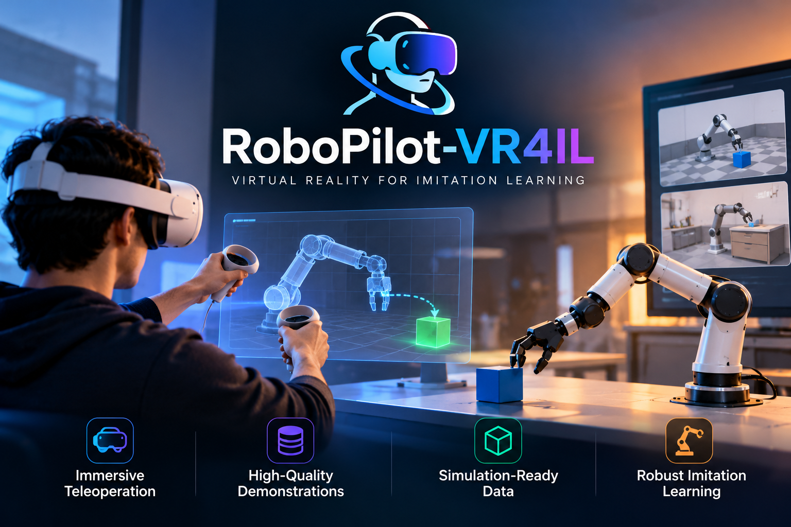

# RoboPilot-VR4IL

RoboPilot-VR4IL
VR-Assisted Demonstration Capture for Robot Imitation Learning
RoboPilot-VR4IL is a prototype exploring how human demonstrations can be captured, converted into structured trajectory data, and used as a foundation for robot imitation learning.

The project demonstrates a manipulation workflow in which a human moves an object toward a target, the system records its motion as timestamped trajectory data, and the recorded demonstration can be replayed. A scripted robot pick-and-place animation illustrates the intended robot-execution workflow.

Developed for the Meta VR Start Developer Competition 2026.

Overview
Teaching robots to perform manipulation tasks traditionally requires carefully designed control policies, demonstrations, or extensive training data.

RoboPilot-VR4IL explores a demonstration-driven alternative:
1. A human performs a manipulation task.
2. The system captures the object's movement over time.
3. The demonstration is stored as structured trajectory data.
4. The recorded trajectory can be replayed.
5. A robot-execution demonstration illustrates how the task could be transferred to a robotic system.
The long-term goal is to establish a foundation for converting human demonstrations into datasets suitable for imitation-learning workflows.
Key Features
1. Human Demonstration Capture
- Interactive object manipulation in a 3D environment.
- Desktop mouse-based interaction for the current headset-free prototype.
- Recording and stopping demonstrations through the interface.
- Timestamped object position and rotation sampling.
2. Trajectory Recording
- Captures object pose information over time.
- Maintains sample counts and recording duration.
- Saves demonstrations as JSON files.
- Uses Unity's persistent data directory for trajectory storage.
3. Demonstration Replay
- Replays previously recorded object trajectories.
- Reconstructs the demonstrated movement.
- Provides a way to inspect and validate captured demonstrations.
4. Task Completion Detection
- Detects when the manipulated object reaches the target zone.
- Provides visual task-completion feedback.
5. Scripted Robot Demonstration
- Includes a Franka Panda robot visual model.
- Provides a scripted pick-and-place animation.
- Demonstrates a conceptual sequence of approach, grasp, lift, transfer, and release.
Implementation note: The current robot pick-and-place animation is scripted. The Panda model is a static visual representation; actual Panda joint control, inverse kinematics, physics-based grasping, and learned policy execution are not implemented in this prototype.
System Workflow
       Human Demonstration
                |
                v
      Interactive Manipulation
                |
                v
       Trajectory Recording
                |
                v
       Timestamped Object Poses
                |
                v
          JSON Storage
                |
                v
       Demonstration Replay
                |
                v
      Task Completion Detection

       Scripted Robot Demo
                |
                v
       Pick-and-Place Sequence
The demonstration-capture and replay workflow is implemented independently of the scripted robot animation. The current prototype does not yet train a robot policy from the recorded trajectories.
Technology Stack
Component	Technology
Development environment	Unity
Programming language	C#
3D simulation	Unity 3D
Robot visual model	Franka Panda
VR development foundation	Meta XR SDK
Input	Mouse and keyboard; VR interaction path
Trajectory format	JSON
Data storage	Unity persistent data directoryProject Structure
The following describes the main logical components of the prototype:
RoboPilot-VR4IL/
│
├── Assets/
│   └── RoboPilot/
│       ├── Robot/
│       │   └── FrankaPanda/
│       │       ├── Generated/
│       │       └── Source/
│       │
│       └── Scripts/
│           ├── VRObjectGrabber.cs
│           ├── TargetZoneDetector.cs
│           └── RoboPilotScriptedRobot.cs
│
├── Packages/
├── ProjectSettings/
└── README.md
The layout is illustrative. Actual Unity asset locations may vary depending on the project checkout.
Getting Started
Prerequisites
- Unity Editor compatible with the project version.
- Unity Input System package.
- Meta XR SDK and related project dependencies.
- Windows PC for desktop-based interaction.
Setup
1. Clone the repository:
   git clone <YOUR_REPOSITORY_URL>
2. Open Unity Hub.
3. Select Add Project and choose the cloned project directory.
4. Open the project using the compatible Unity Editor version.
5. Open the main demonstration scene.
6. Verify that the scene contains:
   - Panda robot visual model.
   - Worktable.
   - Demo object.
   - Target zone.
   - Demonstration recording and robot demonstration components.
7. Enter Play mode.
Running the Demonstration
Human demonstration
1. Start Play mode.
2. Click Record in the trajectory control panel.
3. Move the demonstration cube using the mouse.
4. Move the cube into the target zone.
5. Stop recording.
6. Inspect the recording status, sample count, and saved trajectory path.
Trajectory replay
1. Use the replay control to replay the captured demonstration.
2. Observe the cube following its recorded movement.
3. Reset the object when necessary.
Scripted robot demonstration
1. Reset the environment.
2. Click Execute Robot in the robot demonstration panel.
3. Observe the scripted pick-and-place sequence.
4. Use Reset to restore the initial state.
Keyboard shortcuts:
- Space — Execute robot demonstration.
- Backspace — Reset robot demonstration.
- P — Replay trajectory.
- R — Reset demonstration object.
Trajectory Data
Demonstrations are saved in JSON format under:
Application.persistentDataPath/
└── RoboPilot/
    └── Trajectories/
        └── trajectory_YYYYMMDD_HHMMSS.json
Each recorded sample represents the object's pose at a particular point in time.

The trajectory data provides a starting point for future dataset processing, temporal analysis, coordinate transformations, and imitation-learning experiments.
Current Implementation Status
Capability	Status
3D manipulation environment	Implemented
Human object manipulation	Implemented
Timestamped pose recording	Implemented
JSON trajectory persistence	Implemented
Trajectory replay	Implemented
Target-zone completion detection	Implemented
Franka Panda visual model	Integrated
Scripted pick-and-place demonstration	Prototype
Actual Panda joint-level control	Not implemented
Physics-based robotic grasping	Not implemented
Trajectory-driven robot execution	Not implemented
Imitation-learning model training	Future work
Learned policy evaluation	Future work
Physical robot deployment	Future workFuture Roadmap
RoboPilot-VR4IL is intended to evolve beyond demonstration capture into a broader robot-learning workflow.

Potential future directions include:
- Native VR hand-tracked demonstration capture.
- Collection of demonstrations from multiple users.
- Robot-coordinate and end-effector trajectory transformation.
- Dataset validation and preprocessing.
- Integration with simulation-based imitation-learning pipelines.
- Training and evaluation of learned manipulation policies.
- Physics-based robot control and grasping.
- Sim-to-real transfer and physical robot deployment.
Why RoboPilot-VR4IL?
Human demonstrations provide an intuitive way to communicate manipulation tasks to robots.

RoboPilot-VR4IL explores how immersive interaction, structured trajectory capture, and robotic simulation can form the foundation of a reusable demonstration-driven robot-learning workflow.

Rather than treating a demonstration as just a visual recording, the project focuses on capturing structured motion data that can eventually be used by learning systems.
Competition
Meta VR Start Developer Competition 2026

Project: RoboPilot-VR4IL
Author
Developed independently as a prototype exploring VR-assisted robot demonstration capture and imitation learning.

RoboPilot-VR4IL — From Human Demonstrations to Robot Learning.